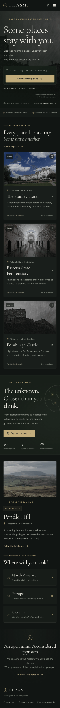
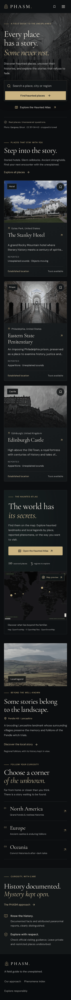
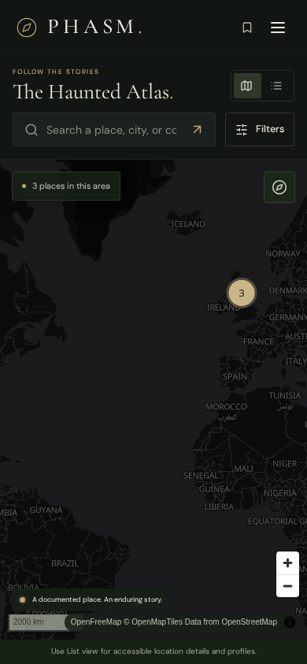
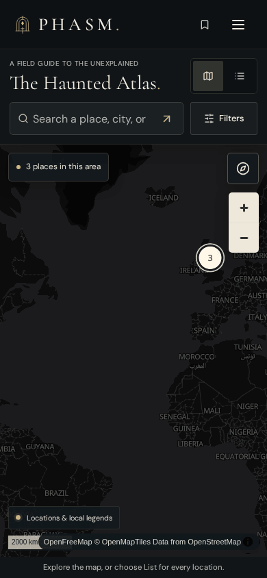
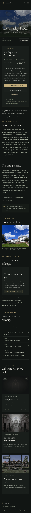
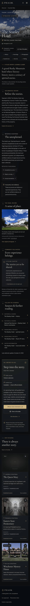

# PHASM Phase 1.1 — visual and mobile review

[Open the refined Cloudflare preview](https://phasm-phase-1-1-preview.wj7djnw2j2.workers.dev) · [Open the preserved Phase 1 preview](https://phasm-phase-1-preview.wj7djnw2j2.workers.dev)

This refinement is on `dev/phasm-phase-1-1`, descended from the preserved `9da89485891f07d584a426d487f707af6ef06f46` commit. It adds no locations, community functionality, services, or production routes.

## What changed

- A cinematic homepage uses the existing, licensed Eastern State Penitentiary photograph, controlled shadows, a stronger headline, a prominent search field, and a nearby Haunted Atlas action.
- An architectural doorway mark, charcoal/slate surfaces, warm ivory type, brass details, and restrained plum report labels create a consistent visual identity. Cards distinguish a location's documented identity from reported phenomena.
- The atlas has clearer markers and selection, larger touch targets, a compact mobile preview, an independent scrolling filter panel, and viewport-aware map sizing. Search, filtering, clustering, geographic queries, and list navigation remain intact.
- Location profiles now read as structured dossiers, with jump links, clearly separated history and reported hauntings, readable sources, credited photography, and visiting information. Community experiences remain explicitly planned.
- Mobile typography, buttons, navigation, safe-area spacing, keyboard dismissal, and reduced motion were refined. The MapLibre browser worker is now a Vite-managed asset, making production packaging reproducible.

## Before and after

These are actual browser screenshots. “Before” was captured from the preserved Phase 1 HTTPS preview; “after” was captured from the refined application at the same sizes. Full-page captures were scrolled to load photographs before capture. Mobile checks used browser emulation, not a physical iPhone.

| Screen | Before: mobile 390 × 844 | After: mobile 390 × 844 | Before: desktop 1440 × 1000 | After: desktop 1440 × 1000 |
| --- | --- | --- | --- | --- |
| Homepage | [View](before/homepage-mobile.png) | [View](after/homepage-mobile.png) | [View](before/homepage-desktop.png) | [View](after/homepage-desktop.png) |
| Haunted Atlas | [View](before/map-mobile.png) | [View](after/map-mobile.png) | [View](before/map-desktop.png) | [View](after/map-desktop.png) |
| The Stanley Hotel | [View](before/stanley-hotel-mobile.png) | [View](after/stanley-hotel-mobile.png) | [View](before/stanley-hotel-desktop.png) | [View](after/stanley-hotel-desktop.png) |

### Homepage

| Before | After |
| --- | --- |
|  |  |

### Haunted Atlas

| Before | After |
| --- | --- |
|  |  |

### The Stanley Hotel

| Before | After |
| --- | --- |
|  |  |

## Content and imagery integrity

All ten location records, histories, reports, classifications, coordinates, visiting information, source URLs, and original image files are unchanged. The homepage photograph retains its existing CC BY-SA 4.0 attribution to Gangway Ghost and links to the Wikimedia Commons source; its crop and tonal presentation are disclosed. Other location photographs retain their existing credits and source links.

`public/images/atlas-preview.webp` is an actual screenshot of PHASM's functioning geographic map. It is clearly labelled as a map preview and links to the interactive atlas. Attribution remains visible in the screenshot and as linked text: [OpenFreeMap](https://openfreemap.org/) · [OpenMapTiles](https://openmaptiles.org/) · [OpenStreetMap contributors](https://www.openstreetmap.org/copyright). It is not a fabricated map or additional documentary photograph.

## Isolation and deployment

The new Worker is `phasm-phase-1-1-preview`. It reads the existing `phasm-phase-1-preview-db` database through a wrapper that disables writes, administrative access, development routes, and community submissions. No migrations or imports are needed or performed for this visual phase. The original `wrangler.jsonc`, production resources, and Phase 1 Worker remain unchanged.

The preview uses the previously confirmed Workers Free account; no subscription changes, paid services, R2, or custom domains are introduced. Credentials remain in Wrangler's authorization workflow. Preview responses request no indexing, and `robots.txt` disallows crawling; the preview URL itself is publicly accessible for evaluation.

See [deployment instructions](../../deploy/preview/README.md) for a fresh build, explicit configuration validation, dry run, and deployment. Avoid the default application configuration for preview publication.

## Verification

- All eight existing backend tests passed, including geographic aggregation beyond 5,000 records and closed community submissions.
- All sixteen existing browser checks passed, covering navigation, images, search, filters, map tiles, marker previews, zoom, profiles, saved locations, and locked editorial access.
- All seventeen supplemental mobile checks passed at widths of 375, 390, and 430px, plus a short 375 × 667 viewport and menu orientation changes. These check readable form text, touch targets, image loading, map gestures without page scrolling, viewport fit, reduced motion, and keyboard focus containment/restoration.
- Nine automated axe WCAG A/AA scans reported zero violations. No uncaught application errors were recorded.
- The production build and isolated Cloudflare deployment dry run passed. The MapLibre browser worker is included as a fingerprinted JavaScript asset.
- Source comparison confirms that the Worker API, editorial implementation, shared types, migrations, location records, original image files, and original Wrangler configuration are unchanged.

See [detailed QA and screenshot records](screenshots.md), [browser results](local-browser-results.json), and [mobile results](local-mobile-results.json). These are automated and visual checks, not a complete accessibility or production load audit.

## Scope and limits

There are no known unresolved issues in the verified core workflows. Browser testing cannot establish physical iPhone/Safari behavior; use the HTTPS preview for that final device evaluation. Map tiles and Google Fonts remain external services. Existing planned account, case-file, and community functionality stays identified as planned. Free-tier limits still apply; this phase does not certify production load capacity or complete launch preparation.
